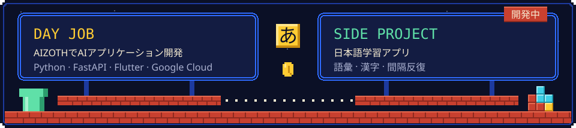
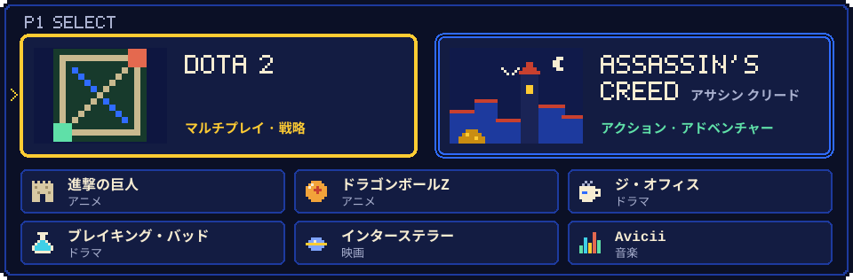
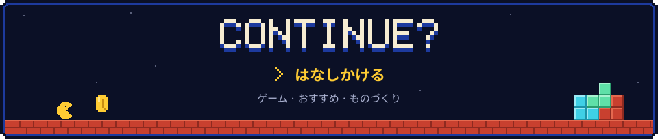

<samp>**[ポートフォリオ](https://tanvirahamed.dev/)** · **[LinkedIn](https://www.linkedin.com/in/tanvirkse/)** · **[メール](mailto:tanvirahamedksejp@gmail.com)** · **[English](README.md)**</samp>

 

<samp>**タンヴィル**です。バングラデシュ出身で、いまは茨城県つくば市に住んでいます。 
**[AIZOTH](https://aizoth.com)** でAIアプリケーションの開発をしています。 
ベンガル語・英語・日本語を話します。</samp>

 

<samp>**本業 · AIZOTH** 
Python、FastAPI、Flutter、Google Cloud を使ったAIアプリケーション開発。AIの機能を、実際に使われるアプリにつなげる仕事です。</samp>

<samp>**個人開発 · 日本語学習アプリ** — `開発中` 
語彙、漢字、間隔反復による復習。[プロジェクトについて →](https://tanvirahamed.dev/projects/japanese-learning-platform/)</samp>

 

<samp>**Python / FastAPI** · **Flutter / Dart** · **AI agents / RAG** · **Google Cloud / Docker**</samp>

<samp><b>以前使っていた技術と、ほかのリポジトリ</b></samp>

 

<samp>以前：Django · Flask · Laravel · Ruby on Rails · Spring Boot · Angular · TypeScript · PostgreSQL · MySQL · MongoDB · Redis · AWS</samp>

- <samp>[python-translator](https://github.com/tanvirkse101/python-translator) — Python · 翻訳 + 漢字検索</samp>
- <samp>[ecommerce-backend](https://github.com/tanvirkse101/ecommerce-backend) — Python</samp>
- <samp>[Go-CRUD-API](https://github.com/tanvirkse101/Go-CRUD-API) — Go</samp>
- <samp>[CSE440Assignments](https://github.com/tanvirkse101/CSE440Assignments) — Python · Dots and Boxes（大学の課題）</samp>
- <samp>[すべてのリポジトリ →](https://github.com/tanvirkse101?tab=repositories) · [経歴 →](https://tanvirahamed.dev/experience/)</samp>

 

<samp>**ダッカ → 宮崎 → つくば。** バングラデシュから九州へ、そしていまはつくばへ。[くわしくはこちら →](https://tanvirahamed.dev/about/)</samp>

 

<samp>オフの日は **Dota 2**、**アサシン クリード**、そして **Avicii** のサウンドトラック。 
ほかにも：進撃の巨人 · ドラゴンボールZ · ジ・オフィス · ブレイキング・バッド · インターステラー</samp>

 

<picture>
  <source media="(prefers-color-scheme: dark)" srcset="https://raw.githubusercontent.com/tanvirkse101/tanvirkse101/output/github-snake-dark.svg">
  
</picture>

<samp><b>GitHubの統計</b></samp>

 

 

<samp>ゲームの話、おすすめ作品の交換、何かを作る相談まで。気軽に声をかけてください。</samp>

<samp>**[メール](mailto:tanvirahamedksejp@gmail.com)** · **[LinkedIn](https://www.linkedin.com/in/tanvirkse/)** · **[ポートフォリオ](https://tanvirahamed.dev/)**
</samp>