

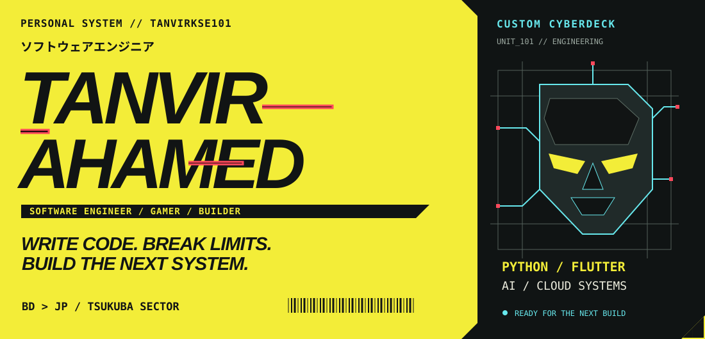

**🇧🇩 Bangladesh → 🇯🇵 Japan · ゲーム好き · ソフトウェアエンジニア**

[Portfolio](https://tanvirahamed.dev/) · [LinkedIn](https://www.linkedin.com/in/tanvirkse/) · [English](README.md) · [Email](mailto:tanvirahamedksejp@gmail.com)

こんにちは、**タンヴィル**です。つくば在住。Dota 2、アサシン クリード、アニメ、映画、Avicii。そして、ものづくりも好きです。

**বাংলা · English · 日本語** でどうぞ。

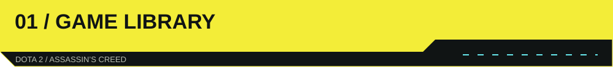

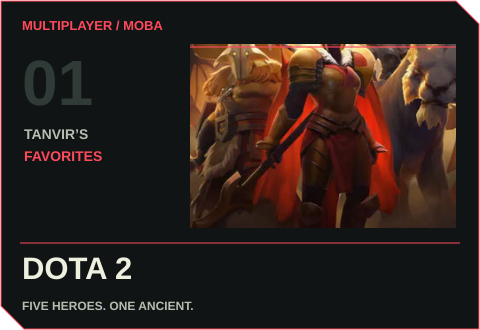
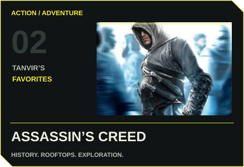

**Dota 2** と **アサシン クリード**。違う世界、どちらも好きなゲーム。おすすめがあれば、ぜひ。

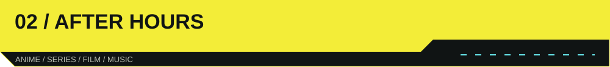

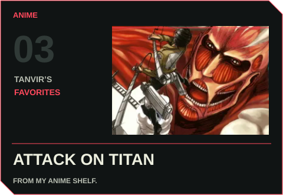
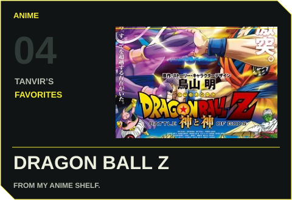

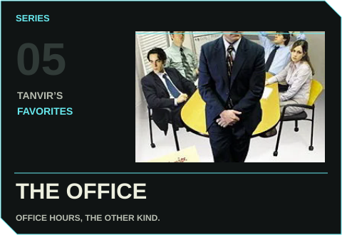
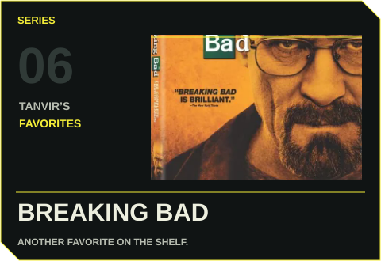

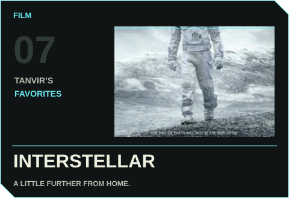
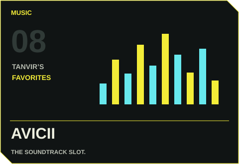

好きな作品と音楽。イラストの権利は各権利者に帰属します。画像は自分のポートフォリオ掲載素材から。イコライザーは装飾アニメーションです。

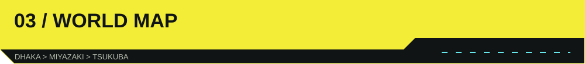

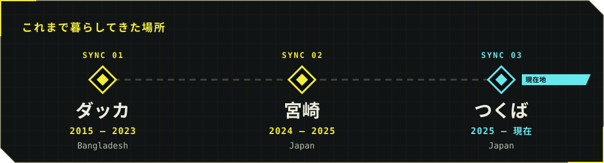

**ダッカ → 宮崎 → つくば。** バングラデシュから日本へ。今の暮らしの拠点はつくばです。 [自己紹介 →](https://tanvirahamed.dev/about/)

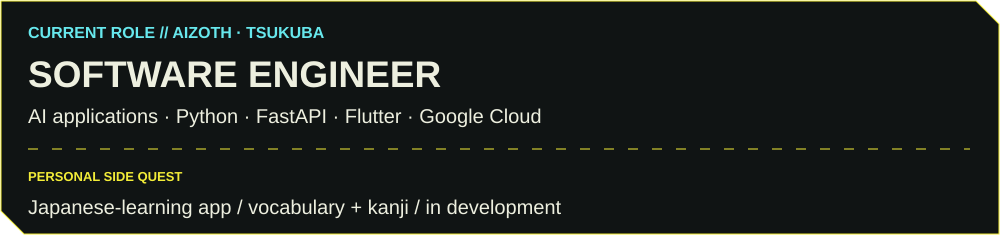

**[AIZOTH](https://aizoth.com)** でAIアプリケーションを開発しています。個人では **[日本語学習アプリ](https://tanvirahamed.dev/projects/japanese-learning-platform/)** を開発中です。

<b>作業机をのぞく / 技術とプロジェクト</b>

**Python · FastAPI · Flutter · Dart · RAG · AI agents · Google Cloud · Docker**

- [Japanese translation tool](https://github.com/tanvirkse101/python-translator) — Python / translation + kanji lookup.
- [Dots and Boxes](https://github.com/tanvirkse101/CSE440Assignments) — two-player terminal game / university coursework.
- [Experience](https://tanvirahamed.dev/experience/) · [All repositories](https://github.com/tanvirkse101?tab=repositories)

<picture>
  <source media="(prefers-color-scheme: dark)" srcset="https://raw.githubusercontent.com/tanvirkse101/tanvirkse101/output/github-snake-dark.svg">
  
</picture>

<b>STATS SCREEN</b>

<a href="mailto:tanvirahamedksejp@gmail.com">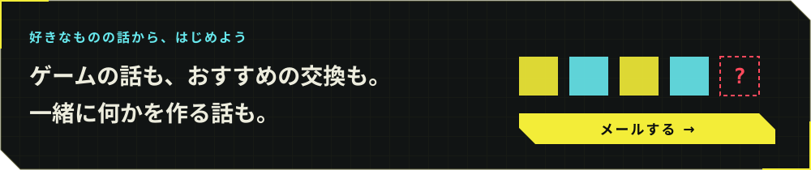</a>

ゲーム、アニメ、音楽のおすすめでも、一緒に何かを作る話でも。気軽にどうぞ。

**[Email](mailto:tanvirahamedksejp@gmail.com)** · **[Portfolio](https://tanvirahamed.dev/)**
