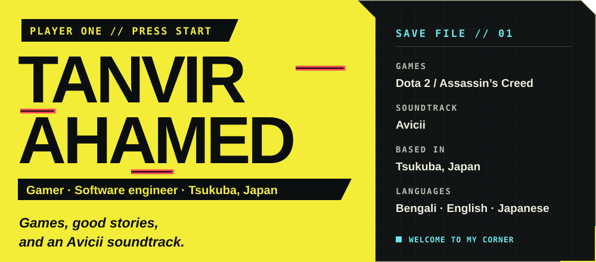
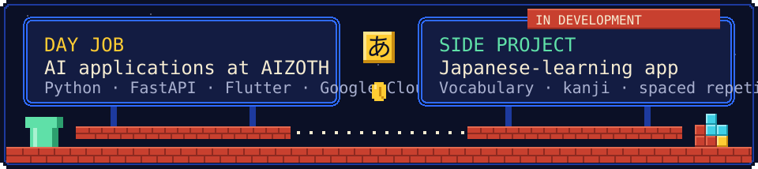
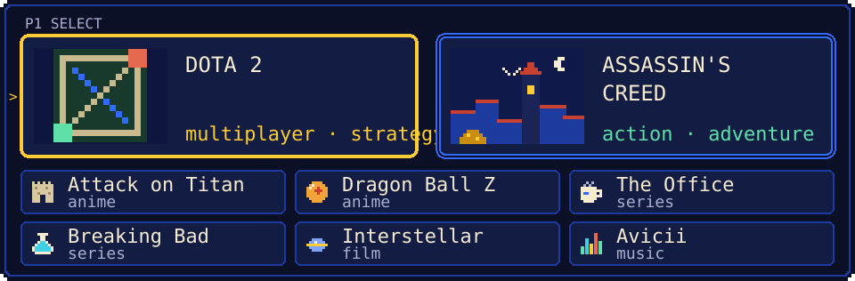
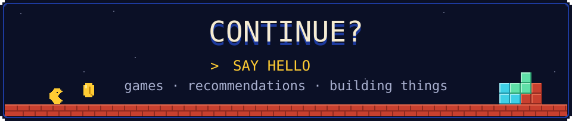

<samp>**[Portfolio](https://tanvirahamed.dev/)** · **[LinkedIn](https://www.linkedin.com/in/tanvirkse/)** · **[Email](mailto:tanvirahamedksejp@gmail.com)** · **[日本語](README-ja.md)**</samp>

 

<samp>I’m **Tanvir**, originally from Bangladesh and now living in Tsukuba, Japan. 
I work on AI applications at **[AIZOTH](https://aizoth.com)**. 
I speak Bengali, English, and Japanese.</samp>

 

<samp>**Day job · AIZOTH** 
AI applications with Python, FastAPI, Flutter, and Google Cloud. Most of the work is connecting AI features to applications people actually use.</samp>

<samp>**Side project · Japanese-learning app** — `IN DEVELOPMENT` 
Vocabulary, kanji, and spaced-repetition review. [Project notes →](https://tanvirahamed.dev/projects/japanese-learning-platform/)</samp>

 

<samp>**Python / FastAPI** · **Flutter / Dart** · **AI agents / RAG** · **Google Cloud / Docker**</samp>

<samp><b>Earlier tools and more repositories</b></samp>

 

<samp>Earlier: Django · Flask · Laravel · Ruby on Rails · Spring Boot · Angular · TypeScript · PostgreSQL · MySQL · MongoDB · Redis · AWS</samp>

- <samp>[python-translator](https://github.com/tanvirkse101/python-translator) — Python · translation + kanji lookup</samp>
- <samp>[ecommerce-backend](https://github.com/tanvirkse101/ecommerce-backend) — Python</samp>
- <samp>[Go-CRUD-API](https://github.com/tanvirkse101/Go-CRUD-API) — Go</samp>
- <samp>[CSE440Assignments](https://github.com/tanvirkse101/CSE440Assignments) — Python · Dots and Boxes, university coursework</samp>
- <samp>[All repositories →](https://github.com/tanvirkse101?tab=repositories) · [Experience →](https://tanvirahamed.dev/experience/)</samp>

 

<samp>**Dhaka → Miyazaki → Tsukuba.** From Bangladesh to Kyushu, and now Tsukuba. [The longer version →](https://tanvirahamed.dev/about/)</samp>

 

<samp>Off duty: **Dota 2**, **Assassin’s Creed**, and an **Avicii** soundtrack. 
Also on the shelf: Attack on Titan · Dragon Ball Z · The Office · Breaking Bad · Interstellar</samp>

 

<picture>
  <source media="(prefers-color-scheme: dark)" srcset="https://raw.githubusercontent.com/tanvirkse101/tanvirkse101/output/github-snake-dark.svg">
  
</picture>

<samp><b>GitHub stats</b></samp>

 

 

<samp>Up for talking games, swapping recommendations, or building something? Say hello.</samp>

<samp>**[Email](mailto:tanvirahamedksejp@gmail.com)** · **[LinkedIn](https://www.linkedin.com/in/tanvirkse/)** · **[Portfolio](https://tanvirahamed.dev/)**
</samp>