<div align="center">


**[ 日本語 ](README-ja.md)** · **[ PORTFOLIO ↗ ](https://tanvirahamed.dev)** · **[ LINKEDIN ↗ ](https://www.linkedin.com/in/tanvirkse)**

`[ CYBERDECK_101 ]`　`[ SYSTEM READY ]`

**Write code. Break limits. Build the next system.**

</div>

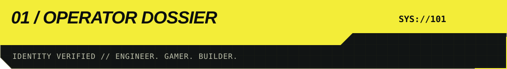

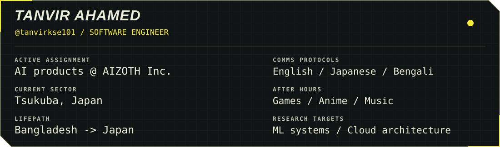

Tsukuba-based software engineer at **AIZOTH Inc.** Building AI products with **Python, Flutter, and cloud infrastructure**. I trace the fault, patch the system, and keep building. After hours: games, anime, music.

**Origin:** Bangladesh → Japan · **Comms:** English / 日本語 / বাংলা

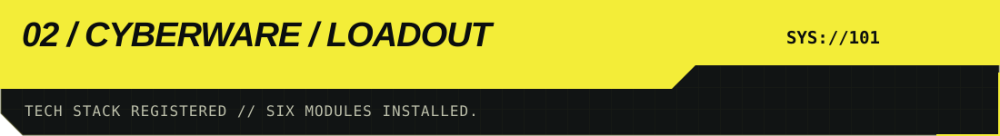

<p align="center">
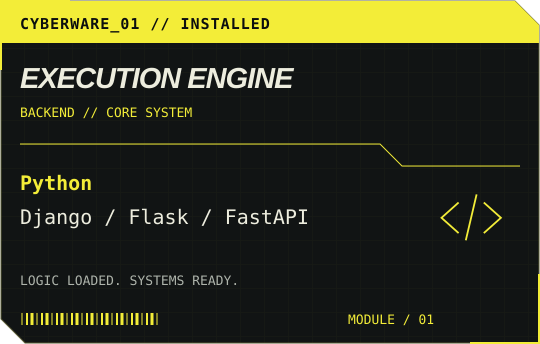
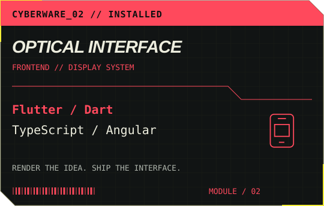
</p>

<p align="center">
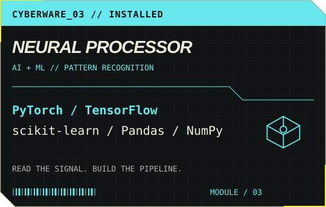
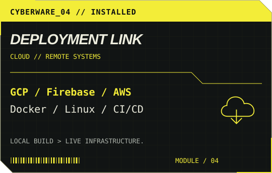
</p>

<p align="center">
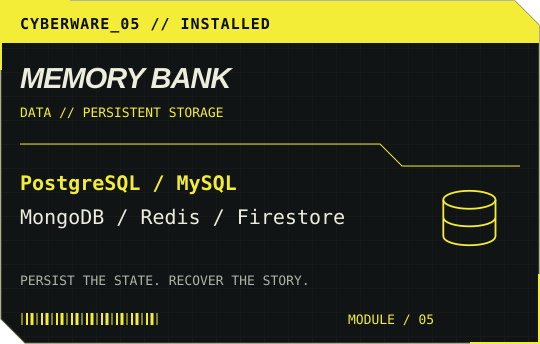
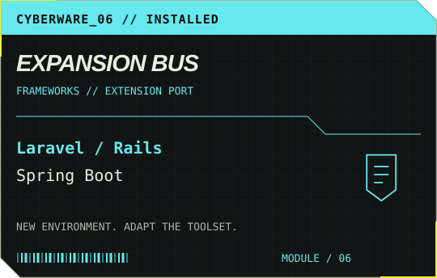
</p>

<details>
<summary><b>SCAN CYBERWARE / tech stack manifest</b></summary>

- **Execution Engine** — Python, Django, Flask, FastAPI
- **Optical Interface** — Flutter, Dart, TypeScript, Angular
- **Neural Processor** — PyTorch, TensorFlow, scikit-learn, Pandas, NumPy
- **Deployment Link** — GCP, Firebase, AWS, Docker, Linux, CI/CD
- **Memory Bank** — PostgreSQL, MySQL, MongoDB, Redis, Firestore
- **Expansion Bus** — Laravel, Rails, Spring Boot

</details>

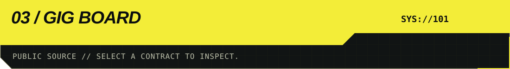

**Choose a gig. Jack into the source.**

<p align="center">
<a href="https://github.com/tanvirkse101/ecommerce-backend">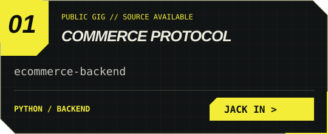</a>
<a href="https://github.com/tanvirkse101/python-translator">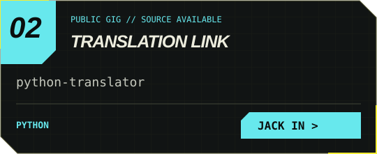</a>
</p>

<p align="center">
<a href="https://github.com/tanvirkse101/Go-CRUD-API">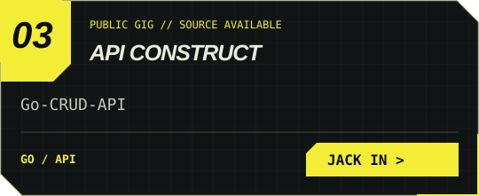</a>
<a href="https://github.com/tanvirkse101/CSE445_Credit_Card_Fraud">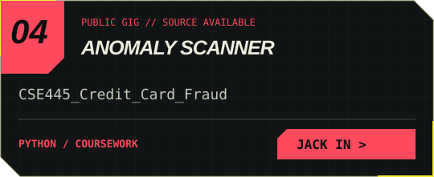</a>
</p>

<p align="center">
<a href="https://github.com/tanvirkse101/B-jet-Programming-Contest">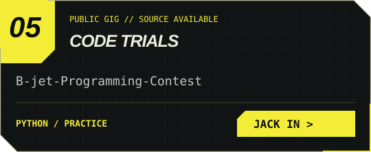</a>
<a href="https://github.com/tanvirkse101/blog-app">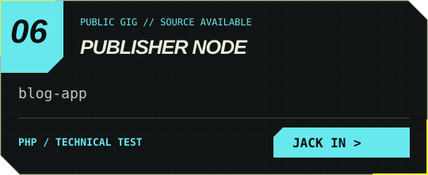</a>
</p>

<details>
<summary><b>GIG INDEX / source links</b></summary>

- [ecommerce-backend](https://github.com/tanvirkse101/ecommerce-backend)
- [python-translator](https://github.com/tanvirkse101/python-translator)
- [Go-CRUD-API](https://github.com/tanvirkse101/Go-CRUD-API)
- [CSE445_Credit_Card_Fraud](https://github.com/tanvirkse101/CSE445_Credit_Card_Fraud)
- [B-jet-Programming-Contest](https://github.com/tanvirkse101/B-jet-Programming-Contest)
- [blog-app](https://github.com/tanvirkse101/blog-app)

</details>

[ SCAN ALL PUBLIC REPOS → ](https://github.com/tanvirkse101?tab=repositories)

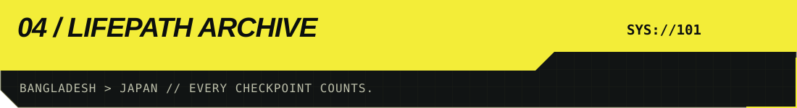

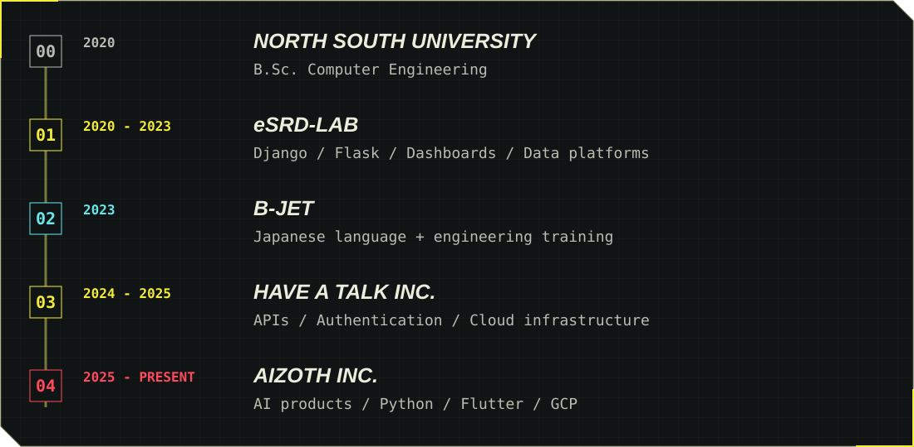

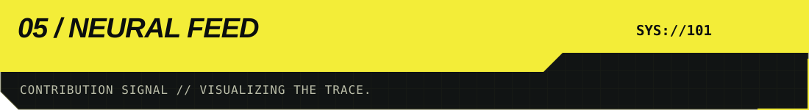

<picture>
  <source media="(prefers-color-scheme: dark)" srcset="https://raw.githubusercontent.com/tanvirkse101/tanvirkse101/output/github-snake-dark.svg">
  
</picture>

<details>
<summary><b>▸ READ SYSTEM TELEMETRY / GitHub activity</b></summary>


<sub>Repository-generated activity snapshot.</sub>

</details>

<details>
<summary><b>▸ DECRYPT HIDDEN SHARD / access granted</b></summary>

```python
class Cyberdeck101:
    spawn = "Bangladesh"
    checkpoint = "Tsukuba, Japan"
    inventory = ["Python", "Flutter", "AI", "Cloud"]

    def encounter(self, bug):
        evidence = self.read_logs(bug)
        patch = self.build_fix(evidence)
        return self.test(patch)  # no victory screen until it passes
```

<sub>Operator pseudocode. Inspect the gig board for working projects.</sub>

**SHARD DECRYPTED:** The best upgrade is understanding why it broke.

</details>

<a href="mailto:tanvirahamedkse@gmail.com">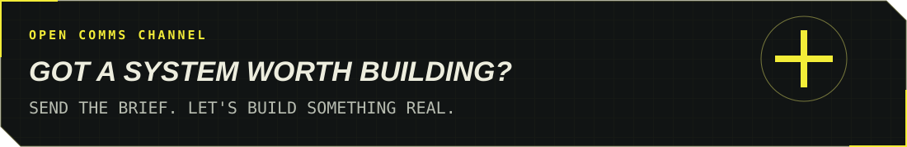</a>

<div align="center">

**[ OPEN COMMS ↗ ](mailto:tanvirahamedkse@gmail.com)** · **[ PERSONAL NETNODE ↗ ](https://tanvirahamed.dev)**

`SESSION PERSISTED`　◆　`END TRANSMISSION`

</div>
