

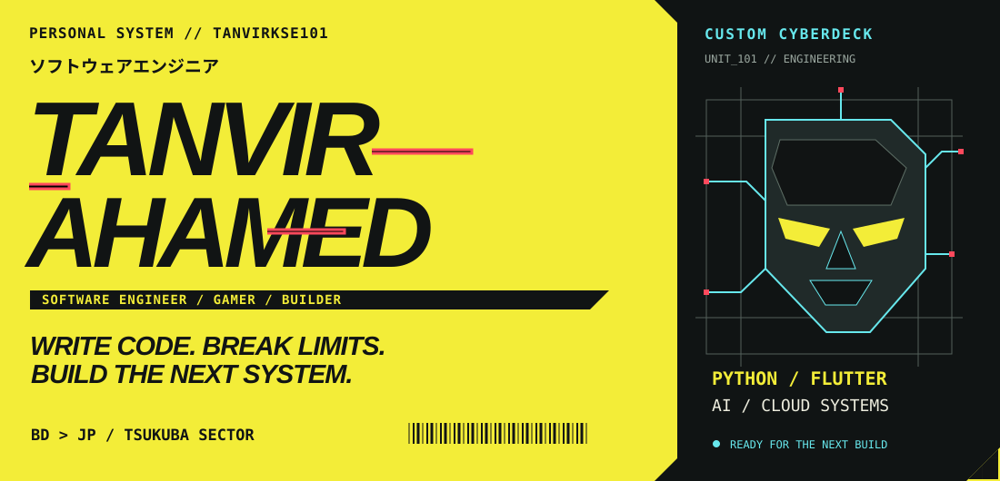

**🇧🇩 Bangladesh → 🇯🇵 Japan · Gamer · Software engineer**

[Portfolio](https://tanvirahamed.dev/) · [LinkedIn](https://www.linkedin.com/in/tanvirkse/) · [日本語](README-ja.md) · [Email](mailto:tanvirahamedksejp@gmail.com)

Hey, I’m **Tanvir**, based in Tsukuba, Japan. Dota 2, Assassin’s Creed, anime, films, and an Avicii soundtrack. I build software, too.

**বাংলা · English · 日本語** — pick a language and say hello.

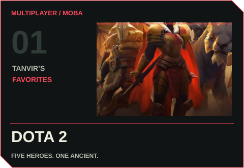
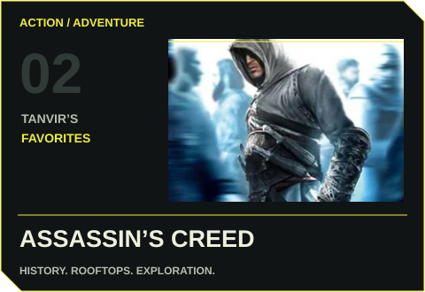

**Dota 2** and **Assassin’s Creed**. Different worlds, both favorites. Got a recommendation for the next game?

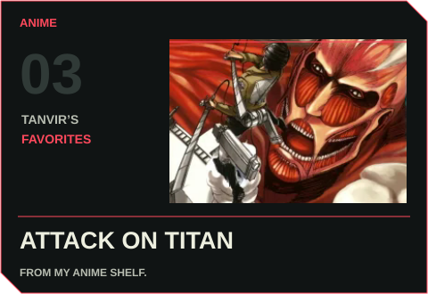
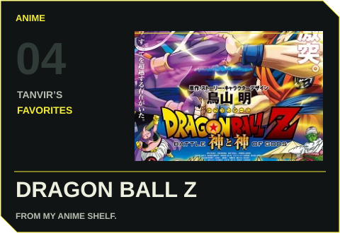

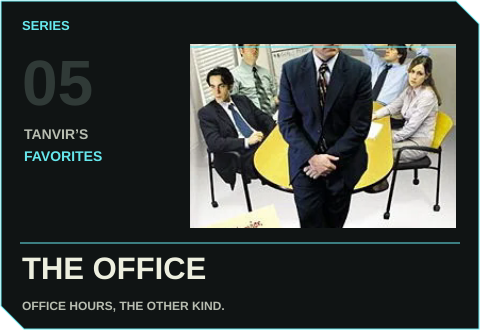
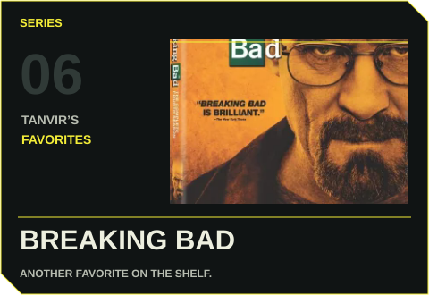

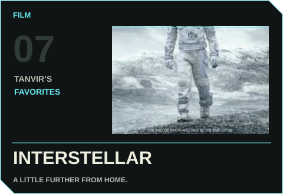

Favorites from my [portfolio](https://tanvirahamed.dev/about/). Artwork belongs to its respective owners. The equalizer is decorative, not live playback.

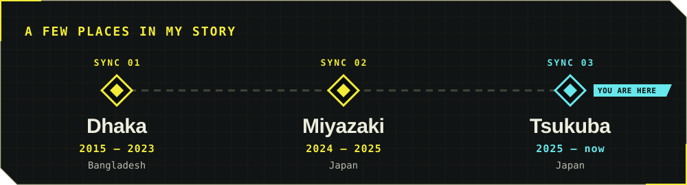

**Dhaka → Miyazaki → Tsukuba.** From Bangladesh to Japan. These days, Tsukuba is home. [More about me →](https://tanvirahamed.dev/about/)

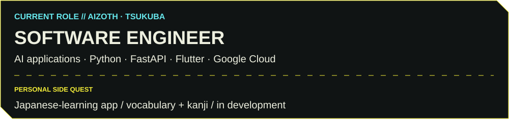

I work on AI applications at **[AIZOTH](https://aizoth.com)**. My personal **[Japanese-learning app](https://tanvirahamed.dev/projects/japanese-learning-platform/)** is still in development.

<b>OPEN WORKBENCH / skills + projects</b>

**Python · FastAPI · Flutter · Dart · RAG · AI agents · Google Cloud · Docker**

- [Japanese translation tool](https://github.com/tanvirkse101/python-translator) — Python / translation + kanji lookup.
- [Dots and Boxes](https://github.com/tanvirkse101/CSE440Assignments) — two-player terminal game / university coursework.
- [Experience](https://tanvirahamed.dev/experience/) · [All repositories](https://github.com/tanvirkse101?tab=repositories)

<picture>
  <source media="(prefers-color-scheme: dark)" srcset="https://raw.githubusercontent.com/tanvirkse101/tanvirkse101/output/github-snake-dark.svg">
  
</picture>

<b>STATS SCREEN</b>

<a href="mailto:tanvirahamedksejp@gmail.com">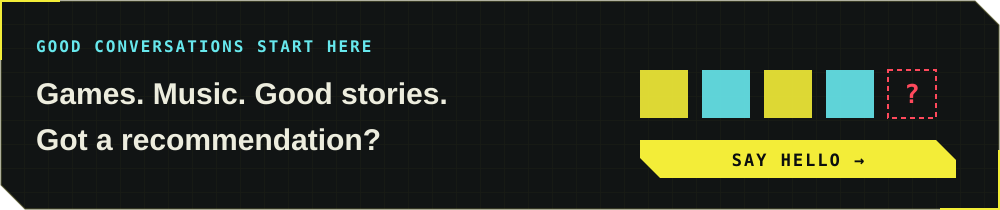</a>

Game recommendations, anime, music, or something worth building together. All good reasons to say hello.

**[Email](mailto:tanvirahamedksejp@gmail.com)** · **[Portfolio](https://tanvirahamed.dev/)**
